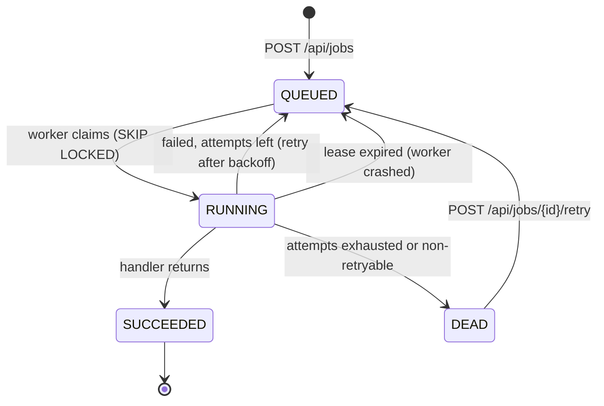

# postgres-job-queue

[](https://github.com/tanmay0922/postgres-job-queue/actions/workflows/ci.yml)


A durable background job queue that uses **PostgreSQL as the broker**. Any number of
worker instances pull from one `jobs` table using `FOR UPDATE SKIP LOCKED`, so a job
is never handed to two workers at once and no extra infrastructure (Redis, RabbitMQ,
Kafka) is needed.

It includes retries with exponential backoff and jitter, a dead-letter state, lease
heartbeats with automatic recovery from crashed workers, idempotent enqueueing, and a
small REST API.

## Why PostgreSQL as a queue?

Most apps already run Postgres. Keeping jobs in the same database means:

- **Transactional enqueue**: a job can be inserted in the same transaction as the
  business data that caused it, so you never get "order saved but email job lost".
- **One less system** to run, secure and monitor.
- **Queryable state**: "show me every failed job from the last hour" is a SQL query.

The trade-off is throughput: a dedicated broker handles far more messages per second.
For thousands of jobs a minute, which covers most business workloads, Postgres is
plenty.

## How it works



### Claiming without double-processing

Each worker leases jobs with a single statement:

```sql
update jobs j
   set status = 'RUNNING', locked_by = :worker, locked_at = now(), attempts = j.attempts + 1
  from (select id from jobs
         where status = 'QUEUED' and run_at <= now()
         order by priority desc, run_at, id
         limit :limit
         for update skip locked) ready
 where j.id = ready.id
returning j.*;
```

`FOR UPDATE` locks the selected rows; `SKIP LOCKED` makes other workers pass over
rows that are already locked instead of waiting on them. Workers therefore never
block each other and never get the same row. A partial index on
`(priority desc, run_at, id) where status = 'QUEUED'` keeps this fast as finished
jobs pile up.

### Leases, heartbeats and crash recovery

A claimed job carries `locked_by` and `locked_at`. While a handler runs, the worker
refreshes `locked_at` every `visibility-timeout / 3`. If a worker crashes or hangs,
its heartbeats stop, and a reaper on every instance moves jobs whose lease is older
than `visibility-timeout` back to `QUEUED` (or to `DEAD` if no attempts are left).

Every transition out of `RUNNING` is guarded by `locked_by = :worker`, which works as
a fencing token: a slow worker whose lease was taken over cannot overwrite the result
recorded by the new owner.

### Retries

A failed attempt is rescheduled with exponential backoff and "equal jitter":
`delay = min(max, base * 2^(attempt-1))`, with the upper half randomised so jobs that
failed together don't all retry at the same moment. Throwing
`NonRetryableJobException` (for example, for an invalid payload) skips the retries
and goes straight to `DEAD`.

### Delivery guarantee

**At-least-once.** If a worker dies after the handler finished but before the result
was saved, the job runs again, so handlers should be idempotent. Enqueueing can be
made idempotent too: pass an `idempotencyKey` and a repeated request returns the
original job instead of creating a duplicate.

## Writing a handler

```java
@Component
class SendWelcomeEmail implements JobHandler {

    @Override
    public String type() {
        return "email.welcome";
    }

    @Override
    public void handle(Job job, JsonNode payload) {
        mailer.send(payload.path("to").asText(), "Welcome!");
    }
}
```

Two example handlers ship with the app: `demo.sleep` (`{"millis": 250}`) and
`demo.flaky` (`{"failTimes": 2}`, which fails its first N attempts so you can watch
retries).

## Running it

**Quickest: no Postgres or Docker needed.** Needs Java 21. Starts the app against a throwaway embedded PostgreSQL:

```bash
./mvnw spring-boot:test-run -Dspring-boot.run.main-class=com.tanmay.jobqueue.LocalJobQueueApplication
```

**With Docker** (Postgres + one API instance + two extra workers):

```bash
docker compose up --build
```

**Locally** with Java 21 and a Postgres you already have:

```bash
export DATABASE_URL=jdbc:postgresql://localhost:5432/jobs DATABASE_USERNAME=jobs DATABASE_PASSWORD=jobs
./mvnw spring-boot:run
```

Flyway creates the schema on startup.

## API

| Method | Path | Description |
|---|---|---|
| `POST` | `/api/jobs` | Enqueue. `201` for a new job, `200` with the original job for a repeated `idempotencyKey` |
| `GET` | `/api/jobs/{id}` | One job |
| `GET` | `/api/jobs?status=DEAD&limit=50` | Jobs by status, newest first |
| `GET` | `/api/jobs/stats` | Count per status |
| `POST` | `/api/jobs/{id}/retry` | Re-queue a `DEAD` job with fresh attempts (`409` otherwise) |

```bash
curl -X POST localhost:8080/api/jobs -H 'Content-Type: application/json' -d '{
  "type": "demo.flaky",
  "payload": {"failTimes": 2},
  "priority": 5,
  "maxAttempts": 5,
  "delaySeconds": 0,
  "idempotencyKey": "demo-1"
}'

curl localhost:8080/api/jobs/stats
# {"QUEUED":0,"RUNNING":0,"SUCCEEDED":1,"DEAD":0}
```

Errors are returned as RFC 9457 problem details.

## Configuration

| Property | Default | Meaning |
|---|---|---|
| `jobqueue.worker-enabled` | `true` | Run workers in this instance (turn off for API-only nodes) |
| `jobqueue.concurrency` | `4` | Jobs processed at once per instance |
| `jobqueue.poll-interval` | `500ms` | Idle wait between polls |
| `jobqueue.visibility-timeout` | `5m` | Lease length without a heartbeat |
| `jobqueue.backoff-base` / `backoff-max` | `2s` / `10m` | Retry delay range |
| `jobqueue.reaper-interval` | `30s` | How often expired leases are released |
| `jobqueue.shutdown-timeout` | `30s` | Grace period for in-flight jobs on shutdown |

## Tests

```bash
./mvnw verify
```

The tests run against a **real PostgreSQL** started in-process by
[embedded-postgres](https://github.com/zonkyio/embedded-postgres), so they need no
Docker. They cover:

- 8 threads racing to claim 300 jobs: every job claimed exactly once
- priority ordering and delayed (`run_at`) jobs
- fencing: a worker that lost its lease cannot record a result
- lease expiry, heartbeats, and the dead-letter transition
- end-to-end worker runs: success, retry-then-succeed, exhausted retries, unknown type
- the REST API, including idempotent enqueue, validation and error codes
- backoff bounds

## Possible next steps

- `LISTEN/NOTIFY` to wake idle workers immediately instead of polling
- Recurring (cron) jobs
- Micrometer metrics: queue depth, job latency, failure rate
- Cleanup of old `SUCCEEDED` rows (or partitioning by `created_at`)

## Tech

Java 21 · Spring Boot 4.1 · Spring JDBC (`JdbcClient`) · PostgreSQL 17 · Flyway ·
JUnit 5 · embedded-postgres · Docker · GitHub Actions
